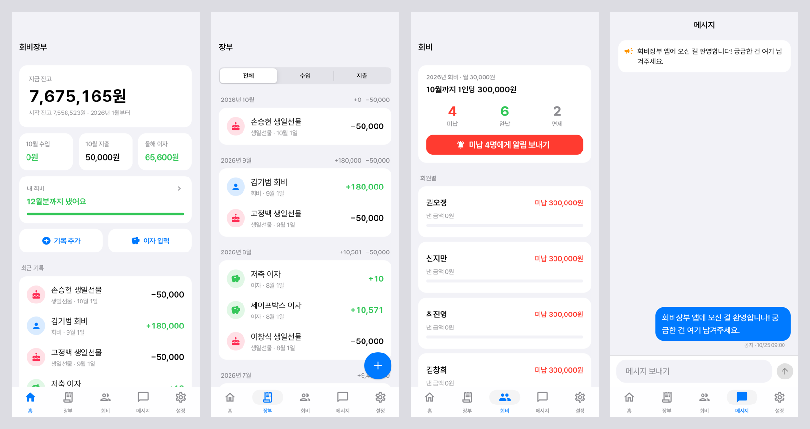
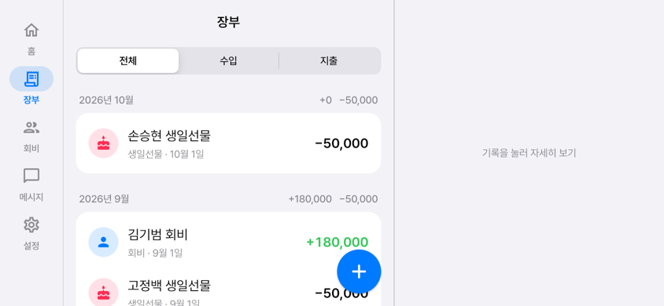

# 회비장부 (KIT_Party)

모임 회비를 관리하는 안드로이드 앱이에요. 총무 한 명이 기록하면 회원 모두의 폰에 바로 반영되고,
회원은 장부를 보고 메시지만 남길 수 있어요.




## 지금 들어 있는 것 (2단계: 앱 뼈대)

- 화면 5개: 홈 · 장부 · 회비 · 메시지 · 설정
- 애플 스타일 디자인 (Pretendard 글꼴, 다크 모드 자동), 잔고 숫자 올라가기·목록 떠오르기 같은 가벼운 모션
- 세로는 하단 탭, 가로·큰 화면은 왼쪽 메뉴 + 장부 2단 화면. 폰 글씨 크기 설정도 따라가요 (최대 1.3배)
- 총무/회원 권한: 기록 추가·수정·삭제, 이자 입력, 면제 설정, 총무 넘기기, 가입 승인은 총무만
- 구글 시트 "2026 제어과 동기" 데이터 50건을 옮겨 둠 (잔고 7,675,165원, 시트와 일치)
- 회비 규칙: 월 3만원(연 36만원), 미리 몰아서 내도 자동 계산, 손승현·이준섭은 2026년 면제

## 실행 모드

| 모드 | 언제 | 데이터 |
| --- | --- | --- |
| 체험 모드 | Firebase 연결 전 (지금) | 시트 데이터가 앱 안에 들어 있고, 바꾼 내용은 저장되지 않음. 설정 → "누구로 볼까요?"로 총무/회원 화면을 바꿔볼 수 있음 |
| 실제 모드 | `lib/firebase_options.dart`가 채워진 뒤 | Firestore 실시간 동기화 + 구글 로그인 |

## Firebase 연결하기 (다음 단계에서 같이 해요)

1. [Firebase 콘솔](https://console.firebase.google.com)에서 프로젝트 만들기
2. Authentication → 로그인 방법 → Google 켜기
3. Firestore Database 만들기 → 규칙 탭에 [`firestore.rules`](firestore.rules) 붙여넣기
4. 이 폴더에서 `flutterfire configure` 실행 → `lib/firebase_options.dart`가 자동으로 바뀜
5. 처음 한 번은 콘솔에서 명단(`members`)과 설정(`config/settings`)을 넣고, 총무 계정의 `users/{uid}` 문서에 `role: treasurer`를 지정

## Firestore 구조

| 경로 | 내용 |
| --- | --- |
| `members/{memberId}` | 이름, 역할, 연결된 로그인 uid, 면제 연도 |
| `users/{uid}` | 로그인 계정 ↔ 회원 연결, 역할 (보안 규칙이 여기서 권한을 읽음) |
| `joinRequests/{uid}` | 가입 신청 (총무가 승인) |
| `transactions/{id}` | 입출금 기록: 날짜, 수입/지출, 분류, 항목, 금액, 관련 회원, 메모, 영수증 |
| `messages/{id}` | 메시지, 공지 고정 여부 |
| `config/settings` | 시작 잔고, 월 회비, 최신 앱 버전, APK 주소 |

## 개발

```bash
flutter pub get
flutter test        # 잔고·미납 계산 + 화면 크기별 테스트
flutter run         # 연결된 안드로이드 폰에서 실행
```

글꼴: [Pretendard](https://github.com/orioncactus/pretendard) (SIL Open Font License, `assets/fonts/OFL.txt`)
